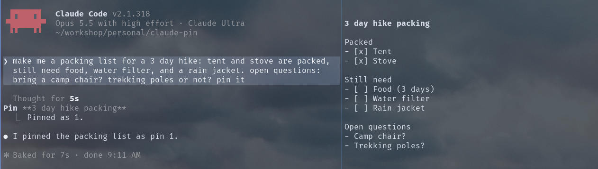

# Pins

A pane beside the chat that holds whatever you pin: a list, a table, a note,
anything in markdown. Pins belong to the conversation: they stay until you
remove them, and come back when you resume it. A setting, "Pins belong to"
under /config, makes one list shared by every conversation instead.

## Motivation

Long sessions bury things. A status summary, the open PRs, the plan agreed
on twenty turns back: each scrolls out of view, and getting it back means
scrolling up or asking Claude again. A pin keeps it beside the chat, and
Claude updates it in place as the work moves.

## Use

- `/pin` shows or hides the pane.
- `/pin <words>` asks Claude to pin something. "the table" pins the table it
  just wrote; "buy milk" pins those words.
- `/unpin <number>` removes one pin, `/unpin all` removes every pin. Each pin
  also has an `x` button in the pane.
- Claude can pin and update pins itself when you ask, and edits a pin in
  place rather than removing and re-adding it.

In the terminal the pane docks beside the transcript from 110 columns in
fullscreen; narrower, it sits above the prompt.

## What it runs and sends

Nothing goes to any service from the mod itself.

**What it sends, and where.**
- Pins stay on this machine, in Claude Code's plugin store, under one key per
  conversation (`pins:<session id>`), or `pins` when shared.
- `/pin <words>` submits one prompt to Claude in your place, `Pin: <words>`,
  through Claude Code's own request to Anthropic. It makes no new connection.
- It sends nothing else, anywhere.

**Which programs it runs, and why.**
- None.

**What it puts in the prompts it submits.**
- Only the `Pin: <words>` line above, and only when you run `/pin` with words.

**What each hook does.**
- `session.start`: adds the `/pin` and `/unpin` commands, the `pin` and
  `unpin` tools Claude calls, loads stored pins and reopens the pane if there
  are any.
- `command.run` for `pin` and `unpin`: toggles the pane, hands words to Claude,
  or removes pins.
- `tool.call` for the mod's own `pin` and `unpin` tools: adds, replaces or
  removes a pin.
- `ui.render` for the pane: draws each pin as markdown with an `x` button.
- `ui.render` for the transcript row of the mod's own `pin` and `unpin` tool
  calls: one line naming the pin, since the pane already shows it; ctrl+o
  shows the full call.
